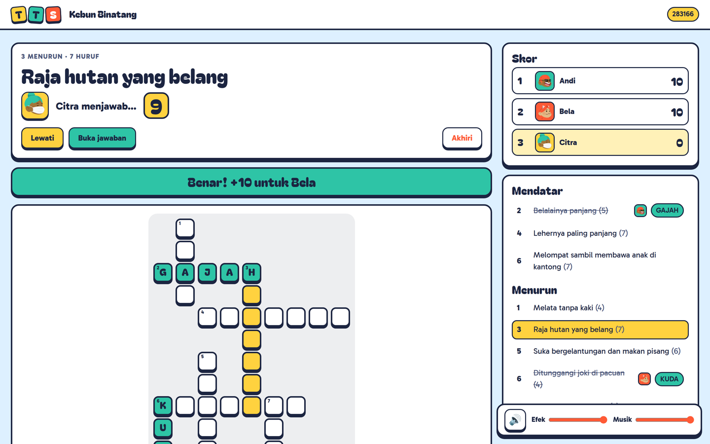
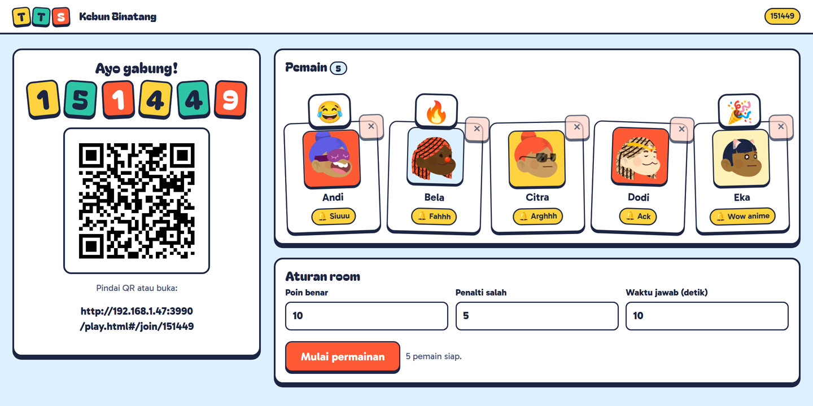
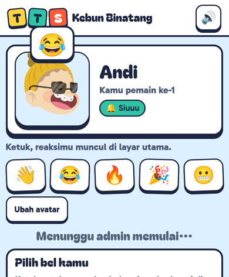
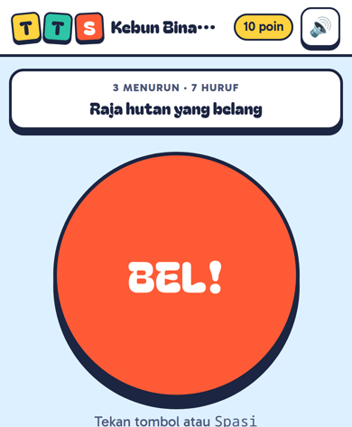
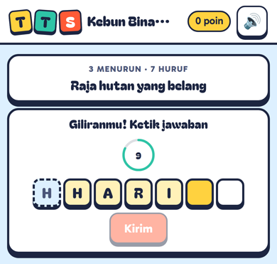
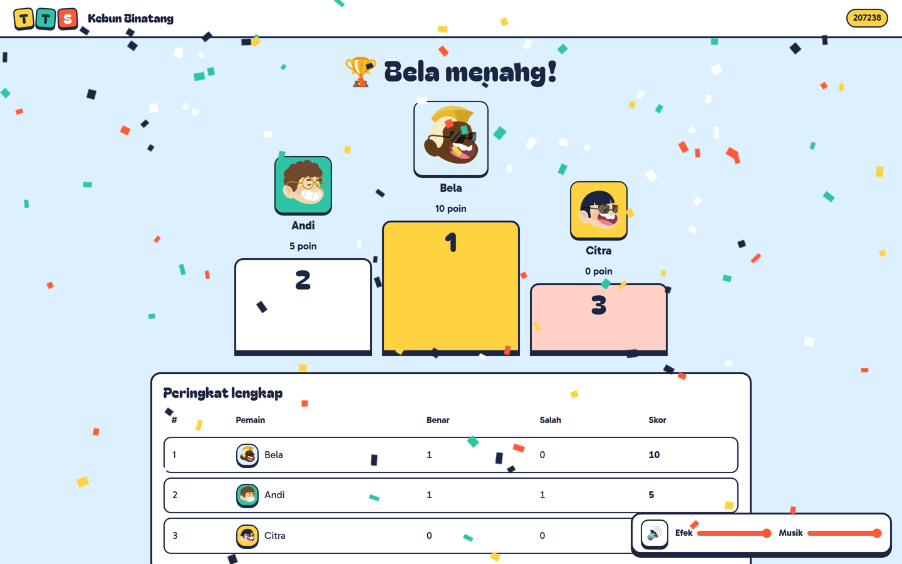
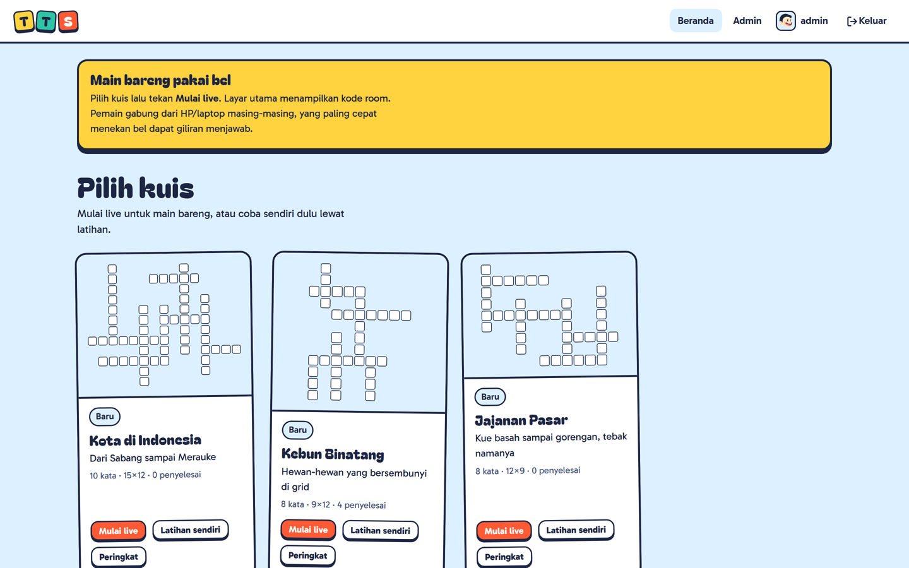

<p align="center">
  
</p>

<h1 align="center">TTS Kuis</h1>

<p align="center">
  Teka-teki silang rame-rame untuk acara offline.<br>
  Satu laptop jadi layar utama, peserta pencet bel dari HP masing-masing, yang paling cepat boleh jawab.
</p>

<p align="center">
  
</p>

## Kenapa

Kuis TTS di acara kantor, kelas, atau arisan biasanya pakai kertas dan tunjuk tangan. TTS Kuis memindahkannya ke layar besar:

- **Bel sungguhan.** Siapa pun yang menekan duluan (dihitung di server, bukan di HP) dapat giliran mengetik. Salah? Bel langsung terbuka lagi untuk yang lain.
- **Tanpa internet.** Satu file program. Font, avatar, QR, dan semua suara sudah di dalamnya. Cukup satu Wi-Fi.
- **Tanpa install di HP.** Peserta pindai QR, isi nama panggilan, pilih avatar dan bel meme, main.

## Mulai cepat

Butuh Go 1.27+.

```sh
go build -o tts ./cmd/tts
go run ./cmd/seed                 # opsional: 4 kuis contoh + 5 akun pemain
ADMIN_PASSWORD='ganti-ini' ./tts
```

Terminal menampilkan alamat Wi-Fi laptop, misalnya:

```
INFO listening url=http://192.168.1.47:3000
```

1. Buka alamat itu di laptop operator, masuk sebagai `admin`.
2. Pilih kuis, klik **Mulai live**. Tab layar utama terbuka. Klik **Aktifkan suara**, lalu sambungkan ke proyektor.
3. Peserta pindai QR di layar (atau buka `/play.html` dan ketik kode 6 angka).
4. Klik **Mulai permainan**, lalu klik petunjuk mana saja di papan.

> Kalau HP peserta tidak bisa membuka alamatnya, biasanya firewall laptop memblokir port. Buka port `PORT` (default `3000`) untuk jaringan lokal.

## Cara main (live)

### Ruang tunggu

<table>
  <tr>
    <td width="68%"></td>
    <td></td>
  </tr>
</table>

Selagi menunggu, peserta bisa menekan reaksi (👋 😂 🔥 🎉 😬) yang muncul sebagai gelembung di atas avatarnya di layar utama, mencoba bel meme yang ikut berbunyi di layar utama, mengetuk avatarnya sendiri supaya melompat, dan mengganti avatar atau bel. Operator mengatur poin, penalti, dan waktu jawab, lalu **Mulai permainan** memunculkan hitung mundur 3‑2‑1 di semua layar.

### Bermain

<table>
  <tr>
    <td width="33%"></td>
    <td width="33%"></td>
    <td></td>
  </tr>
  <tr>
    <td>Bel terbuka: tekan tombol (atau Spasi).</td>
    <td>Giliranmu: huruf dari kata yang bersilangan sudah terisi, tinggal lengkapi.</td>
    <td>Selesai: podium, peringkat, dan riwayat tersimpan.</td>
  </tr>
</table>

| Kejadian | Hasil |
|---|---|
| Operator membuka petunjuk | Bel terbuka untuk semua pemain yang terhubung |
| Pemain pertama menekan bel | Dapat giliran mengetik selama batas waktu (default 10 detik) |
| Jawaban benar | `+poin_benar`, huruf terisi di papan, soal dicoret |
| Salah atau waktu habis | `−penalti_salah`, pemain itu dikunci di soal ini, bel dibuka lagi |
| Semua pemain sudah dapat giliran | Jawaban dibuka di layar utama, tanpa poin |
| **Lewati** | Soal ditandai "dilewati", masih bisa dibuka lagi nanti |
| **Akhiri** / semua soal selesai | Semua jawaban dibuka, podium, hasil disimpan |

Skor seri dipecah oleh total waktu menjawab benar (lebih cepat menang). Skor boleh minus.

**Pengaturan berlapis.** Poin benar, penalti, dan batas waktu diatur global (Admin → Pengaturan), bisa ditimpa per kuis, lalu disesuaikan lagi per room di ruang tunggu. Begitu permainan mulai, pengaturan dikunci.

**Pemain** boleh login (skor tercatat di akun) atau masuk sebagai tamu dengan nama panggilan. Nama unik per room. Refresh atau sinyal putus tidak menghilangkan skor, bel, maupun giliran: pemain otomatis tersambung ke posisinya semula.

## Membuat kuis

Admin bisa menulis di editor (isi kata dan petunjuk, klik **Susun grid**) atau mengimpor file Markdown, satu file satu kuis, banyak file sekaligus:

```md
---
judul: Kebun Binatang
deskripsi: Hewan-hewan yang bersembunyi di grid
poin_benar: 10        # opsional, kosong = ikut pengaturan global
penalti_salah: 5      # opsional
batas_waktu: 10       # opsional, detik
---

- HARIMAU: Raja hutan yang belang
- KUDA: Ditunggangi joki di pacuan
- GAJAH: Belalainya panjang
```

- Hanya `judul` yang wajib. Spasi dan tanda baca di jawaban dibuang (`KOTA BARU` → `KOTABARU`).
- Posisi kata tidak perlu ditulis. Grid disusun otomatis supaya kata saling bersilangan.
- Sebelum disimpan, admin melihat pratinjau grid, kata yang tidak muat, dan baris yang salah lengkap dengan nomornya.

Contoh siap pakai ada di [`cmd/seed/samples/`](cmd/seed/samples).

## Latihan sendiri



Selain live, setiap kuis yang terbit bisa dikerjakan sendiri: isi grid dengan keyboard atau sentuh, periksa jawaban kapan saja, progres tersimpan otomatis, waktu tercepat masuk papan peringkat.

## Suara

Semua suara ada di [`web/sounds/`](web/sounds) dan ikut tertanam di program. Diputar lewat Web Audio dari buffer yang sudah di-decode, jadi bel bunyi tanpa jeda.

| Jenis | Isi |
|---|---|
| Bel pemain | Siuuu, Fahhh, Arghhh, Ack, Wow anime, Saiyan, Bong, Setrum, Kucing nangis, Dexter, Crow Zero, A day in my life |
| Efek permainan | pemain masuk, mulai, soal dibuka, tik-tok (habis tepat saat waktu habis), benar, salah, jawaban dibuka, juara, tepuk tangan, yay |
| Musik layar utama | ruang tunggu, saat bermain (mengecil otomatis saat ada soal aktif), penutup |

Browser menolak memutar suara sebelum ada interaksi, jadi operator perlu menekan **Aktifkan suara** sekali. Layar utama punya kontrol bisu dan slider Efek/Musik. HP pemain punya tombol bisu.

<details>
<summary>Mengganti atau menambah bel</summary>

1. Taruh file `web/sounds/<id>.mp3` (pendek, sebaiknya di bawah 2,5 detik).
2. Tambahkan `<id>` ke `Bells` di [`internal/live/state.go`](internal/live/state.go).
3. Tambahkan label tampilan ke `Sound.BELLS` di [`web/common.js`](web/common.js).
4. Build ulang.

</details>

## Konfigurasi

| Env | Default | Keterangan |
|---|---|---|
| `PORT` | `3000` | Port HTTP |
| `DB_PATH` | `data.sqlite` | File database SQLite |
| `ADMIN_USERNAME` | `admin` | Admin pertama, hanya dibuat jika belum ada admin |
| `ADMIN_PASSWORD` | `admin123` | Ganti sebelum acara |

Build untuk laptop operator lain dari mesin mana pun:

```sh
GOOS=windows GOARCH=amd64 go build -o tts.exe ./cmd/tts
GOOS=darwin  GOARCH=arm64 go build -o tts-mac ./cmd/tts
```

Data contoh (`go run ./cmd/seed`) mengisi 4 kuis (3 terbit, "Sains Dasar" draf), pemain `sari`, `budi`, `dewi`, `rina`, `agus` dengan password `rahasia123`, papan peringkat latihan, dan satu riwayat live. Aman dijalankan berulang.

## Cara kerja

```
cmd/tts            program utama: database, admin pertama, alamat Wi-Fi, server
cmd/seed           data contoh
internal/
  crossword        penyusun grid dan penomoran
  mdimport         impor .md, error per baris
  store            SQLite (modernc.org/sqlite, tanpa CGO)
  auth             bcrypt, cookie sesi
  live             mesin room: satu goroutine per room, jam bisa diganti saat tes
  web              HTTP API, WebSocket, file statis tertanam
web/               frontend tanpa build step (HTML, CSS, JS modul), ikon di web/icons/
docs/spec.md       kontrak lengkap: API, protokol WebSocket, aturan permainan
docs/brand/        ikon master: warna, hitam, putih, navy, ikon aplikasi
```

- **Adil untuk bel.** Setiap room diproses oleh satu goroutine yang menerima kejadian lewat satu antrean. Urutan bel adalah urutan pesan tiba di server, jadi tidak mungkin dua pemain sama-sama menang.
- **Hitung mundur presisi.** Setiap perangkat menyamakan jamnya dengan server lewat pesan `ping`/`pong` ala NTP (mengambil sampel dengan waktu tempuh terkecil). Hitung mundur digambar per frame.
- **Jawaban tidak bocor.** Kunci jawaban tidak pernah dikirim ke pemain atau layar utama sebelum soalnya terjawab atau dibuka.
- **Status permainan di memori.** Hasil akhir disimpan ke SQLite. Kalau server mati di tengah permainan, permainan itu harus diulang.

## Pengembangan

```sh
go test -race ./...
go vet ./...
```

Kontrak API dan WebSocket ada di [`docs/spec.md`](docs/spec.md). Ubah spec dulu sebelum mengubah protokol.

## Kredit

- Avatar: [Big Smile](https://www.dicebear.com/styles/big-smile/) oleh Ashley Seo, lisensi CC BY 4.0, via DiceBear. Dibundel di `web/vendor/avatar.js`.
- Font: [Bagel Fat One](https://fonts.google.com/specimen/Bagel+Fat+One) dan [Gabarito](https://fonts.google.com/specimen/Gabarito), SIL Open Font License.
- Ikon: ubin huruf T yang terangkat, digambar khusus untuk proyek ini (master di `docs/brand/`).
- Musik ruang tunggu "Carefree" oleh Kevin MacLeod (incompetech.com), lisensi CC BY 4.0.
- Efek suara dan bel meme disiapkan oleh pemilik proyek. Pastikan hak pakainya sesuai sebelum aplikasi didistribusikan ke luar acara internal.
